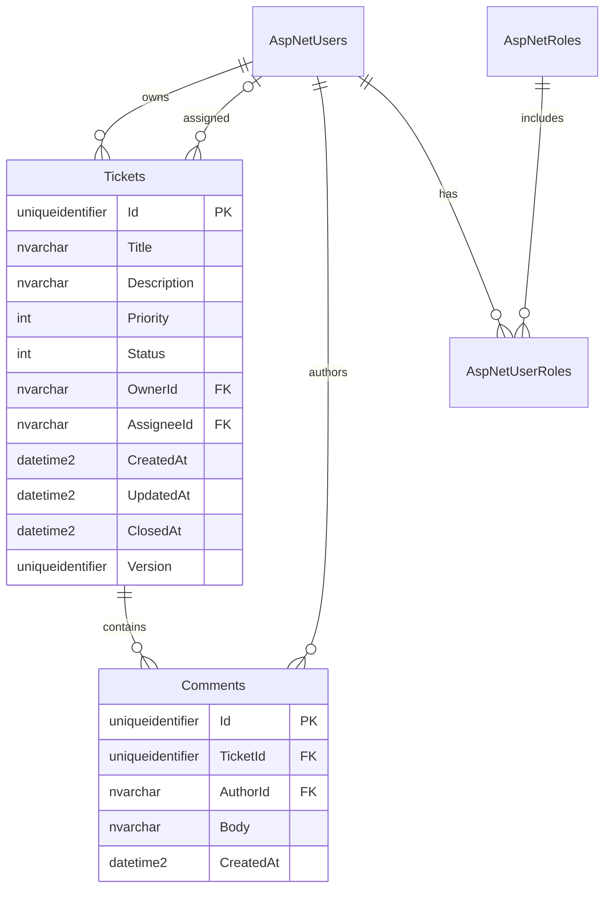

# HelpDesk API

Портфолио-проект сервиса технической поддержки на **C# / .NET 10 / ASP.NET Core Web API / EF Core / SQL Server / xUnit**. Пользователь создаёт заявку, сотрудник поддержки берёт её в работу, общается в комментариях и закрывает после решения. Интерфейс демонстрации - Swagger UI; отдельный сайт не требуется.

## Возможности

- Регистрация, вход и обновление токенов через готовые API ASP.NET Core Identity.
- Заявки с названием, описанием, приоритетом, статусом и датами UTC.
- Создание, просмотр, редактирование, фильтры, сортировка и страницы.
- Роль `Support`, назначение на себя, закрытие и повторное открытие.
- Комментарии с проверкой доступа к родительской заявке.
- Защита от перезаписи изменений через `version` и optimistic concurrency EF Core.
- Ошибки Problem Details, миграции, демоданные, Docker Compose, GitHub Actions.

## Быстрый запуск через Docker (рекомендуется)

Нужен **Docker Desktop с Linux containers и Docker Compose v2**. Для SQL Server нужен x86-64 компьютер; выделите Docker минимум 4 ГБ памяти. SDK .NET на хосте для этого способа не нужен. Docker в среде разработки этого проекта отсутствовал: контейнерный запуск подготовлен, но здесь не выполнялся.

Откройте PowerShell в корне проекта:

```powershell
powershell -ExecutionPolicy Bypass -File scripts/New-LocalSettings.ps1
docker compose up --build -d
docker compose ps
```

Скрипт создаёт локальный `.env` со случайными паролями. При повторном запуске он откажется перезаписывать существующий файл. На Linux/macOS можно выполнить его через `pwsh` либо скопировать `.env.example` в `.env` и задать два разных сложных пароля вручную (от 12 символов, верхний/нижний регистр, цифра и спецсимвол; без `;` и `$`).

Откройте [Swagger UI](http://localhost:5080/swagger) после готовности API. Первый запуск скачивает образы, ожидает базу, применяет миграцию и добавляет примеры. Проверка готовности: [health/ready](http://localhost:5080/health/ready).

Демонстрационные аккаунты:

| Email | Права |
| --- | --- |
| `alice@example.test` | Свои 2 заявки |
| `bob@example.test` | Своя 1 заявка |
| `support@example.test` | Все заявки, взятие в работу и закрытие |

Пароль всех демоаккаунтов - значение **`HELPDESK_DEMO_PASSWORD` из вашего локального `.env`**. Пароль `SQL_SA_PASSWORD` нужен только SQL Server. Изменение `.env` не меняет пароль уже созданных пользователей или сохранённой базы.

Проверить основной сценарий автоматически:

```powershell
powershell -ExecutionPolicy Bypass -File scripts/Smoke.ps1
```

Скрипт создаёт дополнительную заявку и проверяет вход, чужую заявку (`404`), назначение, комментарий, закрытие, запрет редактирования (`409`) и открытие заново.

Остановить: `docker compose down`. Данные и ключи сохраняются в volumes. Команда `docker compose down -v` **удалит базу и ключи**; используйте только для намеренного сброса демонстрации.

## Демонстрация за 5 минут в Swagger

1. Вызовите `POST /api/auth/login` с email Alice и локальным демопаролем. `useCookies` оставьте `false`. Скопируйте `accessToken` из ответа.
2. Нажмите **Authorize**, вставьте только значение токена, без префикса `Bearer`.
3. Получите `GET /api/tickets`, затем создайте заявку через `POST /api/tickets`.
4. Сохраните её `id` и `version`. Во всех изменяющих запросах передавайте актуальный `version` из последнего ответа.
5. Через **Logout** в окне Authorize очистите токен, войдите как Support и замените токен. Вызовите `take`, добавьте комментарий, затем `close`, каждый раз копируя новую версию.
6. Вернитесь к Alice: редактирование закрытой заявки даст `409`; `reopen` разрешит последующее редактирование.
7. Войдите как Bob: обращение к заявке Alice даст `404`. В списке будут только заявки Bob.

`Authorize / Logout` в Swagger очищает токен в интерфейсе, но не отзывает уже выданный токен на сервере. Access token действует 30 минут; refresh token - 7 дней. Это **opaque-токены Identity, не JWT**. После назначения роли необходимо войти заново.

## Локальный запуск .NET + SQL Server

Установите .NET SDK 10 и SQL Server Developer 2022+ либо SQL Server Express LocalDB на Windows. По умолчанию используется `(localdb)\MSSQLLocalDB` с Windows Authentication; в текущей среде LocalDB не установлен. Вместо установки SQL Server можно поднять только базу командой `docker compose up db -d`.

```powershell
dotnet restore HelpDesk.sln --locked-mode
dotnet tool restore
# Если используется LocalDB: создавать экземпляр нужно только один раз.
sqllocaldb create MSSQLLocalDB
sqllocaldb start MSSQLLocalDB
dotnet ef database update --project src/HelpDesk.Api
dotnet run --project src/HelpDesk.Api
```

Для другой базы задайте строку подключения в **текущем терминале**, не в исходниках:

```powershell
# Подставьте свою строку; пример использует Windows Authentication и не содержит пароль.
$env:ConnectionStrings__HelpDesk = 'Server=localhost;Database=HelpDesk;Trusted_Connection=True;Encrypt=True;TrustServerCertificate=True'
dotnet ef database update --project src/HelpDesk.Api
dotnet run --project src/HelpDesk.Api
```

В Development Swagger включён автоматически. Для локального наполнения примерами перед запуском задайте `$env:HelpDesk__SeedDemo = 'true'` и `$env:HelpDesk__DemoPassword` со своим сложным паролем. Сначала примените миграцию. Seed повторно не создаёт пользователей и не дублирует заявки, если таблица заявок уже непустая.

После регистрации сотрудника назначить ему роль можно только из доверенной консоли с доступом к базе:

```powershell
dotnet run --project src/HelpDesk.Api -- --grant-support agent@example.test
```

Указанный пользователь должен быть зарегистрирован. Успех - код выхода `0`. Через публичный API выдать себе роль нельзя. Рабочая база должна быть уже мигрирована. Для подключения с SQL Authentication используйте переменные окружения или `dotnet user-secrets set 'ConnectionStrings:HelpDesk' 'ваша строка' --project src/HelpDesk.Api`; user-secrets хранит данные вне репозитория, но не шифрует их.

## Тесты

```powershell
dotnet restore HelpDesk.sln --locked-mode
dotnet build HelpDesk.sln -c Release --no-restore
dotnet test --solution HelpDesk.sln -c Release --no-build --results-directory TestResults -- --report-trx
```

Используется **xUnit с Microsoft.Testing.Platform**: выбор раннера записан в `global.json`, формат отчёта подключён отдельным пакетом. Синтаксис старого VSTest `--logger trx` здесь не используется.

По умолчанию интеграционные тесты работают на отдельной SQLite in-memory базе для каждого теста с настоящими Identity, маршрутизацией и EF Core. Это не подмена SQL Server в приложении. Для запуска тех же тестов на SQL Server:

```powershell
$env:HELPDESK_TEST_SQLSERVER = 'Server=localhost;Trusted_Connection=True;Encrypt=True;TrustServerCertificate=True'
dotnet test --solution HelpDesk.sln -c Release --no-build
Remove-Item Env:HELPDESK_TEST_SQLSERVER
```

Учётной записи тестовой БД нужны права создавать и удалять **временные базы `HelpDeskTests_<guid>`**. Тесты создают их, применяют настоящую SQL Server миграцию и удаляют при завершении. Используйте отдельный локальный/CI сервер. SQLite не проверяет особенности SQL Server; второй job GitHub Actions предназначен именно для этого.

Проверка согласованности модели и миграций, без подключения к SQL Server:

```powershell
dotnet tool restore
dotnet ef migrations has-pending-model-changes --project src/HelpDesk.Api
dotnet ef migrations script --idempotent --project src/HelpDesk.Api --output docs/schema.sql
```

Фактические результаты локальной проверки и её границы - в [docs/verification.md](verification.md).

## API

| Метод | Маршрут | Назначение |
| --- | --- | --- |
| POST | `/api/auth/register` | Регистрация |
| POST | `/api/auth/login` | Получение токенов |
| POST | `/api/auth/refresh` | Обновление токенов |
| GET | `/api/tickets` | Список, фильтры, сортировка, страницы |
| POST | `/api/tickets` | Создание |
| GET / PUT | `/api/tickets/{id}` | Просмотр / редактирование |
| POST | `/api/tickets/{id}/take` | Support берёт на себя |
| POST | `/api/tickets/{id}/close` | Назначенный Support закрывает |
| POST | `/api/tickets/{id}/reopen` | Владелец или Support открывает снова |
| GET / POST | `/api/tickets/{id}/comments` | Чтение / добавление комментария |
| GET | `/health/live`, `/health/ready` | Процесс / доступность таблицы заявок |

Пример создания (для настоящего запроса замените `$TOKEN` своим токеном):

```bash
curl -X POST http://localhost:5080/api/tickets \
  -H "Authorization: Bearer $TOKEN" \
  -H "Content-Type: application/json" \
  -d '{"title":"VPN недоступен","description":"Ошибка после смены пароля","priority":"High"}'
```

Фильтры: `GET /api/tickets?status=Open&priority=High&sortBy=CreatedAt&descending=true&page=1&pageSize=20`. Допустимы `Low`, `Normal`, `High`, `Critical`; статусы `Open`, `InProgress`, `Closed`; сортировка `CreatedAt`, `UpdatedAt`, `Priority`. По умолчанию новые сверху, страница 1, размер 20; максимум 100 записей. При одинаковом ключе сортировки используется `id`. Числа вместо enum в JSON не принимаются.

Дополнительные примеры: [docs/requests.http](requests.http), [docs/api.md](api.md). Снимок контракта из опубликованной сборки: [docs/openapi.json](openapi.json).

## Архитектура и схема данных

```text
HTTP -> Controllers -> Application/TicketService -> Domain/Ticket
                                 |
                           ITicketStore
                                 |
                     Infrastructure/EfTicketStore -> EF Core -> SQL Server
```

Это один развёртываемый сервис и один проект приложения с разделением по папкам. Контроллеры принимают HTTP и DTO, сервис координирует доступ и сценарии, сущность хранит бизнес-правила, store выполняет запросы. Для такого объёма отдельные сборки, CQRS и универсальный repository добавили бы больше переходов по коду, чем пользы.



Identity также создаёт таблицы claims, logins и tokens. Сотрудник - обычный пользователь с ролью `Support`. Удаление пользователей, связанных с заявками или комментариями, ограничено внешними ключами. Удаление заявок не выставлено в API; удаление строки заявки на уровне БД удалит её комментарии каскадно.

Правила: только Support назначает и закрывает, закрывает только назначенный сотрудник; владелец или Support может редактировать активную заявку и открыть закрытую. Закрытая заявка целиком доступна только для чтения. Повторное открытие снимает исполнителя. У каждой операции над существующей заявкой проверяется доступ; чужая и отсутствующая дают одинаковый `404`.

## Документация и чтение проекта

- [Подробное руководство PDF на русском](../output/pdf/HelpDesk-Development-Guide-RU.pdf).
- [Исходник руководства](development-guide.md): задача, этапы, объяснение каждого инструмента, альтернативы и вариант работы без него.
- [Как читать код по шагам](reading-map.md), с упражнениями и точками остановки.
- [Контракт API и ошибки](api.md).
- [Проверки и ограничения среды](verification.md).

Исходник PDF можно обновить и пересобрать: `python -m pip install -r docs/requirements.txt`, затем `python scripts/build_docs.py`. Нужен шрифт с кириллицей: на Windows используется Arial/Consolas, на Linux DejaVu Sans/Mono (пакет `fonts-dejavu-core`). Подробности в исходнике скрипта.

## Ограничения и дальнейшее развитие

Это локальная портфолио-демонстрация: Compose включает демоданные, миграции при старте и Swagger, подключается к БД как `sa`. Для рабочего развёртывания нужны отдельная ограниченная учётная запись БД, HTTPS на reverse proxy, отдельный шаг миграции, отключённый seed и шифрование ключей Data Protection. Порты Compose привязаны к `127.0.0.1`.

Email-доставка не подключена; Identity публикует также маршруты подтверждения, восстановления и 2FA, но демонстрация использует регистрацию/вход/refresh. Не заявляется готовый почтовый сценарий. Демоаккаунты подтверждены seed-ом; обычная регистрация не требует подтверждения email. У bearer-токенов нет API немедленного отзыва; удаление токена из Swagger его не инвалидирует. Rate limit (30 запросов в минуту на IP на группу Identity) хранится в памяти процесса; для нескольких экземпляров и proxy нужно отдельное решение.

Следующие улучшения: аудит переходов статусов, SLA и поиск, вложения с отдельным хранилищем, email-уведомления, отзыв сессий/OIDC, выдача роли через закрытую админ-панель, перенос слоёв в отдельные сборки при росте проекта. Подсчёт общего количества и чтение страницы - два SQL-запроса: при параллельных изменениях их снимки могут немного различаться.
